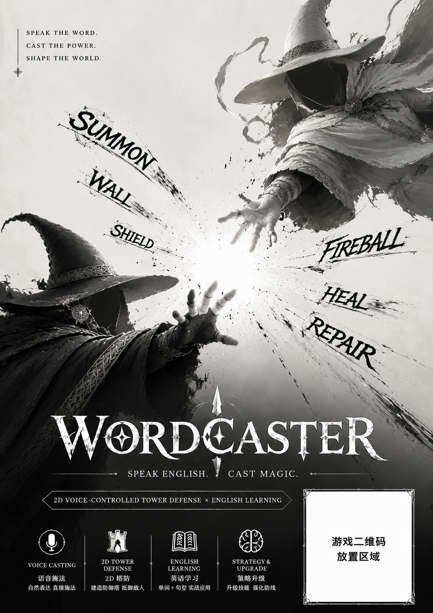
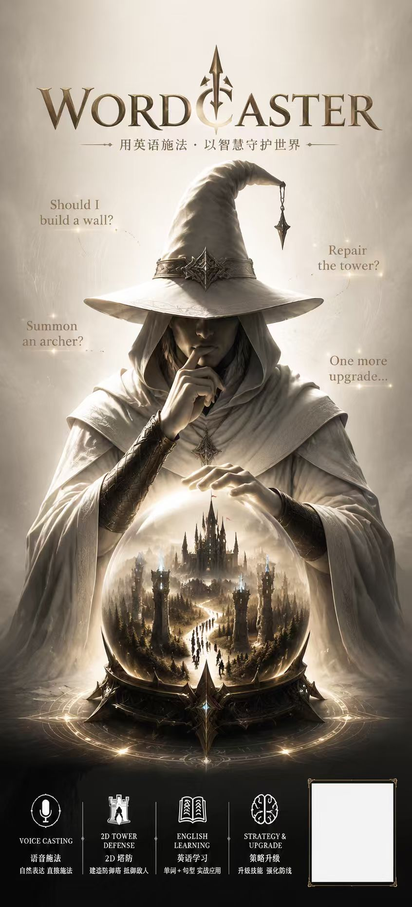
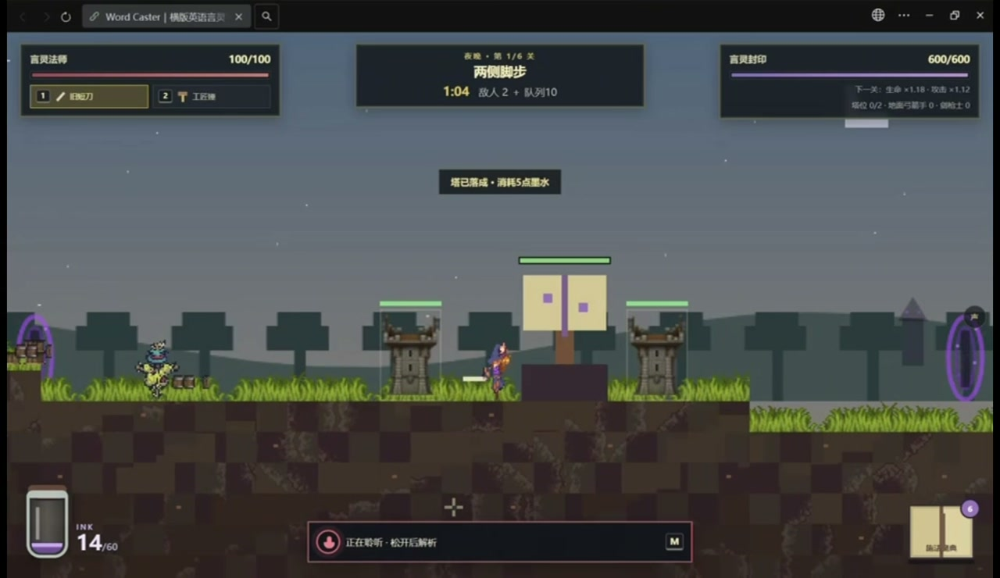
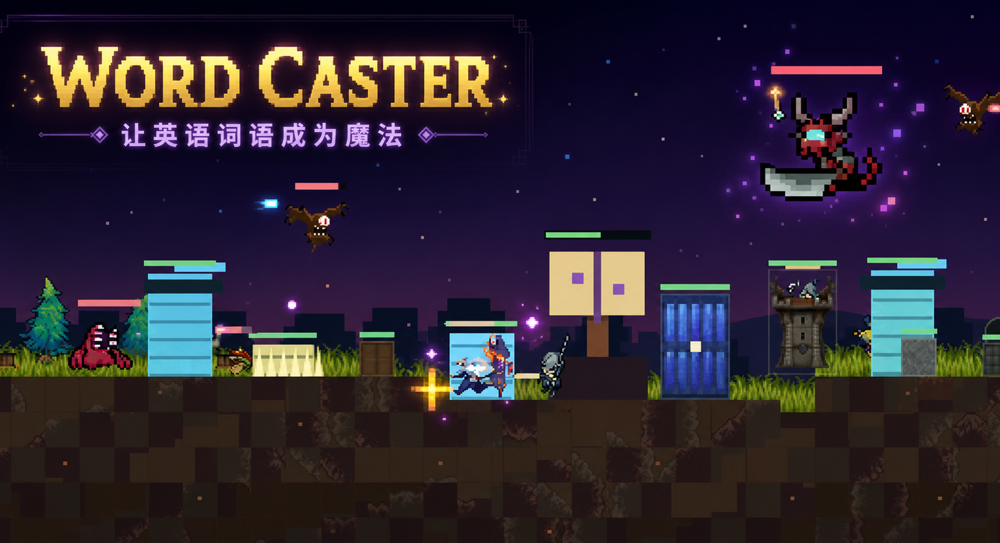

  <h1>Word Caster</h1>
  
<strong>让英语词语成为魔法。</strong>

  
  

[最新演示](#最新演示) · [核心特色](#核心特色) · [操作说明](#操作)

原创中文横版像素言灵守城游戏。玩家是守护“言灵封印”的 Word Caster：
白天在 Caster’s Grimoire 学习英语咒词，夜晚念出词语召唤士兵、
搭建墙、陷阱与炮台，阻挡邪恶法师从召唤门放出的怪物。

战役前3个白昼开放基础建造、四类守军和基础法术，第4个白昼起开放高级言灵。
每个白昼最多首次学习8个词，夜晚可以翻书浏览但不能开始新课程。

## 最新演示

  
<strong>Speak English. Cast Magic.</strong> 用英语施法，以智慧守护世界。

<table>
  <tr>
    <td align="center" valign="top" width="60%">
       
      <b>宣传短海报</b> · <a href="docs/media/wordcaster-poster.png">查看原图</a>
    </td>
    <td align="center" valign="top" width="40%">
       
      <b>易拉宝海报</b> · <a href="docs/media/wordcaster-rollup.jpg">查看原图</a>
    </td>
  </tr>
</table>

### 宣传视频 · 1:35

  
  
<a href="docs/media/wordcaster-promo.mp4"><strong>▶ 观看宣传与玩法演示</strong></a>

从施法魔典中的英语学习，到夜晚建造与守城，视频展示了词语如何成为游戏中的行动。点击封面或上方链接进入视频文件页。

## 游戏画面

## 核心特色

- 将英语单词学习融入语音施法、守城与资源决策
- 支持键鼠、触屏和移动端横屏操作
- 语音不可用时可切换文字输入，不阻断核心玩法
- 包含白昼学习、夜晚战斗、建造、防御塔和高级言灵系统

## 操作

- `A / D`：移动
- `Space`：跳跃
- 鼠标左键：近战或使用工匠锤
- 鼠标右键：放置言灵建筑
- 按住 `M`：开启麦克风，松开后识别
- `E / Tab`：打开施法魔典
- `1 / 2`：切换短刀与工匠锤
- `Esc`：取消、关闭书页或暂停

## 展示范围

本仓库仅包含作品介绍、精选截图、宣传海报与演示视频。项目源码、开发文档和服务端配置不公开。
